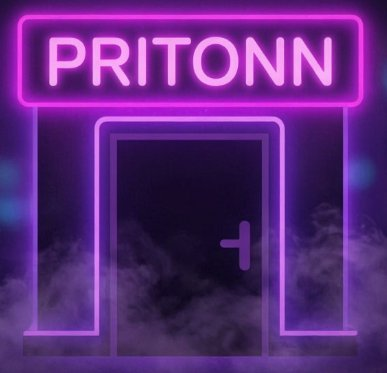

# 🟣 PRITONN Messenger & Social Platform

Современная полнофункциональная платформа для общения в неоновом и Telegram-стиле с поддержкой десктопных приложений (Windows), мобильных (Android APK) и веб-клиента.



---

## 🌟 Основные возможности

### 📞 Голосовые и видеозвонки (WebRTC)
- **Личные звонки (1-на-1)**: звонки с шифрованием, аудио и видеосвязь высокого качества.
- **Групповые голосовые чаты (Voice Rooms)**: групповое общение с индикатором активного говорящего, списком участников и управлением микрофоном.
- **Демонстрация экрана (Screen Sharing)**: одновременный стриминг экрана несколькими участниками с возможностью выбора, чей экран смотреть прямо во время звонка.
- **История звонков**: отображение в личных сообщениях с длительностью, статусами (принят/пропущен) и модальное окно журнала вызовов.

### 💬 Чаты и коммуникации
- **Личные чаты, Группы и Каналы**: публичные каналы с реакциями, счетчиками просмотров (`👁 45.2K`) и правами администратора.
- **Истории (Stories)**: публикация фото-историй, карусель, реакции и тайм-бары.
- **Голосовые и видео-кружочки**: запись с микрофона и камеры с анимацией волны.
- **Опросы и викторины**: анонимные и публичные голосования.
- **Папки чатов**: кастомные вкладки для сортировки чатов.
- **Мини-приложения (Mini Apps)**: встроенные веб-приложения внутри чата.

### 💻 Клиенты
- **Web**: адаптивный интерфейс (PWA) для браузеров.
- **Windows Desktop**: Electron-приложение с нативной рамкой и иконкой в трее.
- **Android**: проект Capacitor с поддержкой разрешений на камеру, микрофон и звонки.

---

## 🚀 Быстрый запуск

### 1. Веб-версия локально:
```bash
# Установка зависимостей
npm install
cd client && npm install
cd ../server && npm install

# Запуск сервера
cd ../server
node server.js
```

### 2. Онлайн-хостинг (бесплатно в 1 клик):
Запустите файл:
```bat
Запустить_Бесплатный_Онлайн_Хостинг.bat
```
Он активирует Cloudflare Tunnel и выдаст безопасную ссылку `https://...trycloudflare.com`, доступную из любой точки мира.

### 3. Сборка Windows .exe:
Запустите:
```bat
Собрать_Windows_Установщик.bat
```

### 4. Сборка Android APK:
Запустите:
```bat
Android_Инструкция_и_Сборка.bat
```

---

## ☁️ Развертывание в облаке (Render / Railway / VPS)

Проект полностью готов для хостинга:
- В репозитории настроен `render.yaml`.
- Вся статика клиента автоматически раздается Express-сервером (`server.js`).
- Поддержка WebSocket и WebRTC на любом порту (`process.env.PORT`).

---

**Разработано для сообщества PRITONN**
